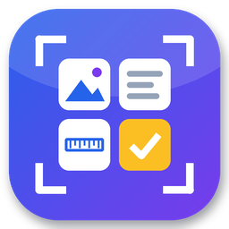

<p align="center"></p>

<h1 align="center">MultiCapture</h1>

<p align="center">A multi-screenshot board for Windows: every capture is kept, laid out in a grid, annotated and copied to the clipboard automatically.</p>

<p align="center"><a href="#english">English</a> · <a href="#中文">中文</a> · <a href="#français">Français</a></p>

---

## English

The built-in Snipping Tool keeps one capture at a time. MultiCapture keeps **all** of them in a history panel, so you can compare, arrange and paste several screenshots at once without saving files.

### Features

- **Nothing is overwritten**: every capture goes into the history panel (and survives a restart).
- **Board views**: Single / 2×2 / 3×3 / 4×4 / All. Drag cells to reorder them.
- **Auto-copy**: the current view (single image or whole grid) is put on the clipboard and pastes straight into Outlook, Word, Excel or Teams.
- **Editable annotations**: pen, highlighter, line, arrow, rectangle, ellipse, numbered markers, stamps, blur and callouts. Everything stays movable and editable.
- **Word-like text boxes**: font, size, bold / italic / underline, colour, background, border and alignment, with a ✥ grip to move them.
- **Tables**: choose rows × columns, drag onto the image, type in the cells (Tab / Enter to move), resize columns and rows, restyle at any time.
- **Symbol panel**: ✓ ✗ ★ → ⚠ ± ° Ø ⌀ ≤ ≥ ① α … in one click, into text, table cells or as a stamp.
- **PDF-style measurement**: distance, perimeter, area and angle, with a calibrated scale.
- **Notes panel** for each screenshot, optionally included in copies and exports.
- **Export** to PNG / JPG / BMP / PDF, either one image or all of them (separate PNG files or one PDF).
- **On close**, the app asks whether to save, with a choice of folder and formats.
- **Delete menu**: delete the selected capture, the current board, or everything.
- **Global hotkey** `Ctrl+Alt+S`. Region, full-screen and last-region modes, with an optional delay.
- **Languages**: English, Français, 中文. A built-in user guide is under Help.
- **Themes**: change the colours, the icon of each function and the decorations, and add a frame to copied or exported screenshots. Flowers, Night and Simple card are included; get new ones with **Get online themes** (the only time the app goes online) or [make your own](docs/THEMES.md).

#### Optional extras (off by default)

Switch each one on in **Options → Extra features**. While a feature is off it adds nothing to the window. None of them needs a download or an internet connection.

- **Pin to screen** (`Ctrl+P`): float a screenshot above all windows. Drag to move, wheel to zoom, Ctrl+wheel for opacity.
- **Text recognition (OCR)** (`Ctrl+T`): extract the text of a screenshot with the OCR engine built into Windows 10/11, offline. Supports every language Windows has OCR for (Chinese, English, French, …).
- **Scrolling capture**: a "Scrolling" capture mode that auto-scrolls a window and stitches it into one long image.
- **Screen recording to GIF** (`Ctrl+R`): record a region or the full screen to an animated GIF (5 / 10 / 15 fps, up to 60 s).

### Download

Get `MultiCapture.exe` from the [latest release](https://github.com/xieganglaoliu/MultiCapture/releases/latest). It is portable: no installer and no Python needed. Windows SmartScreen may warn because the exe is not code-signed; choose **More info → Run anyway**.

### Run from source

Requires Windows 10/11 and Python 3.10+.

```powershell
pip install Pillow
python multicapture.py
```

### Build the single-file .exe

```powershell
pip install -r requirements.txt
powershell -ExecutionPolicy Bypass -File build.ps1
```

This produces `dist\MultiCapture.exe`. The exe is portable: no installer is needed, just double-click it.

You can also add it to the Start menu, so it shows up in Start search and pins cleanly to the taskbar:

```powershell
powershell -ExecutionPolicy Bypass -File install_shortcut.ps1
```

### Files

| File | Purpose |
|---|---|
| `multicapture.py` | The application |
| `extras.py` | Optional features: pin, OCR, scrolling capture, GIF recording |
| `i18n.py` | Translations (fr / zh) and the user guide |
| `themes.py` | Theme packs: loading, frames, import / export, online themes |
| `themes/` | Built-in themes, also the catalog for "Get online themes" |
| `docs/THEMES.md` | How to make a theme |
| `tests/` | Tests for the optional features (`python -m unittest discover tests`) |
| `make_icon.py` | Generates `multicapture.ico` / `.png` |
| `build.ps1` | PyInstaller build script |
| `install_shortcut.ps1` | Optional local install plus Start-menu shortcut |

Session data is stored in `%APPDATA%\MultiCapture\`.

---

## 中文

系统自带的截图工具每次只保留一张。MultiCapture 会把**每一次**截图都保存在左侧的历史栏里，不会被覆盖。

- 支持单张、2×2、3×3、4×4 和全部宫格视图，拖动格子就能调整顺序；
- 当前视图会自动复制到剪贴板，可以直接粘贴到 Outlook、Word、Excel 或 Teams；
- 提供可编辑的标注：画笔、箭头、框、编号、印章、马赛克、标注框，以及类似 Word 的文字框（可设字体、字号、颜色，用 ✥ 拖动）；
- 提供类似 PDF 阅读器的测量功能：距离、周长、面积、角度，可以标定比例；
- 右侧是笔记栏，可以选择是否把笔记一起复制或导出；
- 可导出为 PNG、JPG、BMP 或 PDF；关闭软件时会提示是否保存；
- 「删除」菜单可以删除当前截图、整个宫格或全部截图；
- 全局快捷键 `Ctrl+Alt+S`；界面支持中文、英文、法文，并内置使用说明。
- **主题**：可以更换界面配色、每个功能的图标和装饰图，还能给复制或导出的截图加上边框。自带「鲜花」「夜晚」「简约卡片」，点「获取在线主题」下载新主题（只有这时才联网），也可以[自己制作](docs/THEMES.md)。

可选的扩展功能（默认关闭，在「选项」→「扩展功能」中单独打开，全部离线、无需下载）：

- **贴图置顶**（`Ctrl+P`）：把截图钉在所有窗口最上层，可拖动、缩放、调透明度；
- **文字识别 OCR**（`Ctrl+T`）：使用 Windows 10/11 自带的 OCR 引擎识别截图中的文字，支持中文、英文等；
- **长截图 / 滚动截图**：截图模式中多出「长截图」，自动滚动窗口并拼接成一张长图；
- **录屏 GIF**（`Ctrl+R`）：把屏幕区域或全屏录成 GIF 动图（每秒 5 / 10 / 15 帧，最长 60 秒）。

下载：在 [Releases](https://github.com/xieganglaoliu/MultiCapture/releases/latest) 页面下载 `MultiCapture.exe`，免安装、不需要 Python。

运行源码：`pip install Pillow`，然后执行 `python multicapture.py`。打包：运行 `build.ps1`，生成的 `dist\MultiCapture.exe` 是免安装版，双击即可使用。

---

## Français

L'Outil Capture d'écran ne garde qu'une capture à la fois. MultiCapture les garde **toutes** dans un historique.

- Vues en grille 2×2 / 3×3 / 4×4, réorganisables par glisser-déposer ;
- La vue courante est copiée automatiquement dans le presse-papiers (Outlook, Word, Excel…) ;
- Annotations modifiables et zones de texte de type Word ;
- Mesures façon PDF : distance, périmètre, surface, angle ;
- Panneau de notes, export PNG / JPG / BMP / PDF, demande d'enregistrement à la fermeture ;
- Interface en français, anglais et chinois, avec un guide intégré ;
- Fonctions facultatives, désactivées par défaut (Options → Fonctions supplémentaires) : épingler à l'écran, reconnaissance de texte (OCR de Windows, hors ligne), capture défilante, enregistrement d’écran en GIF ;
- Thèmes : couleurs, icône de chaque fonction, décorations et cadre pour les captures copiées ou exportées ; nouveaux thèmes en ligne ou [faits par vous](docs/THEMES.md).

Téléchargement : `MultiCapture.exe` dans les [Releases](https://github.com/xieganglaoliu/MultiCapture/releases/latest), sans installation ni Python.

Lancement : `pip install Pillow`, puis `python multicapture.py`. Pour créer l'exe portable, lancez `build.ps1`.

---

## License

[MIT](LICENSE)
